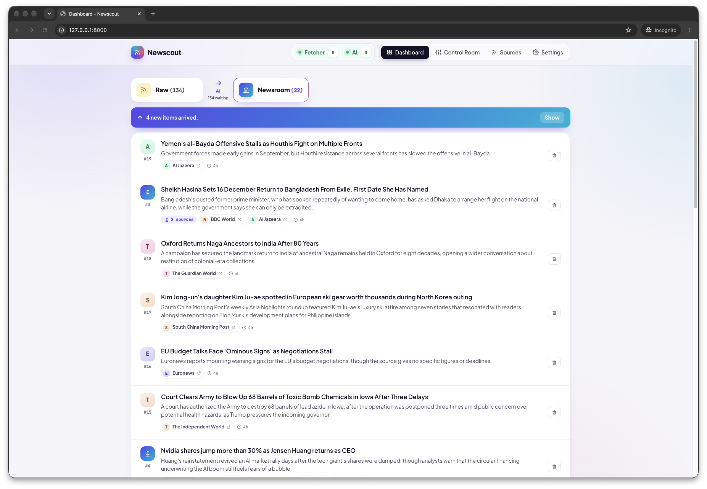
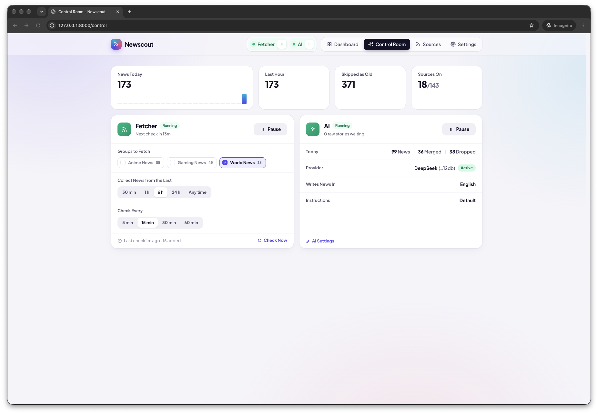

# Newscout

A self-hosted newsroom that collects your RSS feeds and lets AI merge and rewrite them into one clean news list.

## Preview




## Installation

### Requirements

- [uv](https://docs.astral.sh/uv/getting-started/installation/), which installs `Python 3.12` for you.
- Optionally, one of the supported AI providers below.

### Supported AI

- [DeepSeek](https://platform.deepseek.com/api_keys)
- [Ollama](https://ollama.com)
- [LM Studio](https://lmstudio.ai)

### Install

Open a new terminal and follow these steps.

```bash
git clone https://github.com/wereallcode/newscout.git && cd newscout
```

```bash
uv run newscout
```

Open the address the terminal prints, then add your AI provider in Settings → AI.

## TODO

- [ ] Add Docker support.
- [ ] Add authentication support.
